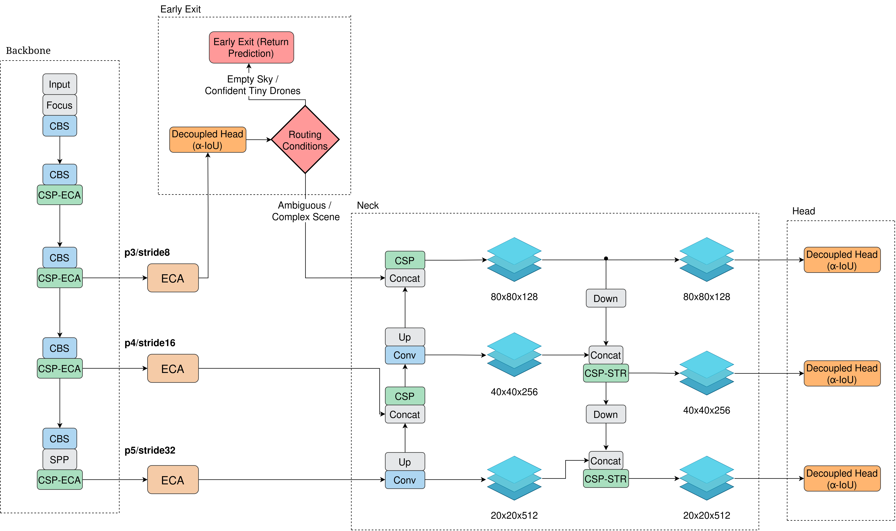

# AeroTrack

AeroTrack is a UAV multi-object tracking framework built on top of YOLOX + ByteTrack, with dynamic early-exit routing for compute-efficient inference in easy frames while keeping full-capacity processing for ambiguous scenes.

> **Paper status:** pre-publication.
> **Paper link (to be updated):** `TBD`

## Highlights

- Dynamic routing with an early-exit branch and decision gate.
- UAV-focused tracking pipeline with IoU and NWD association options.
- Built-in evaluation outputs for MOT metrics, latency, FPS, energy, and routing statistics.
- TensorRT dual-engine path for edge deployment.

## Architecture




## Paper results (v1.0)

These are the values reported in Table V of the paper. The workstation and
Jetson measurements are kept separate because they are not directly
comparable.

### UAVSwarm workstation

| Architecture | Distance | Min latency (ms) | Mean latency (ms) | Max latency (ms) | FPS | Mean power (W) | Total energy (J) |
|:---|:---|---:|---:|---:|---:|---:|---:|
| Baseline | IoU | 6.7 | 8.5 | 215.0 | 117.2 | 33.1 | 1983.9 |
| Baseline | NWD | 6.4 | 8.5 | 208.0 | 117.9 | 33.2 | 1983.9 |
| Early Exit | IoU | 2.9 | 7.7 | 199.2 | 130.7 | 33.0 | 1807.1 |
| **AeroTrack** | **NWD** | **2.9** | **7.7** | **213.0** | **130.7** | **32.8** | **1821.6** |

### Jetson

| Architecture | Distance | Min latency (ms) | Mean latency (ms) | Max latency (ms) | FPS | Mean power (W) | Total energy (J) |
|:---|:---|---:|---:|---:|---:|---:|---:|
| Baseline | IoU | 178.1 | 187.9 | 226.4 | 5.3 | 6.4 | 8924.9 |
| Baseline | NWD | 188.5 | 199.1 | 243.0 | 5.0 | 6.6 | 9641.3 |
| Early Exit | IoU | 68.6 | 157.1 | 230.1 | 6.4 | 6.3 | 7754.4 |
| **AeroTrack** | **NWD** | **65.8** | **152.6** | **240.6** | **6.6** | **6.2** | **7389.6** |

## Later run (2026-09-02)

This later workstation run reported 9.0/8.2 ms mean latency rather than the
Table V values above. The relative AeroTrack gain remained about 9%; the
difference is run-to-run variation, not a change to the method.

| Architecture | Distance | BCET (ms) | Avg (ms) | WCET (ms) | FPS | Peak (W) | Avg (W) | Total (J) | Frame (J) |
|:---|:---|:---:|:---:|:---:|:---:|:---:|:---:|:---:|:---:|
| Baseline | IoU | 6.8 | 9.0 | 190.8 | 111.2 | -- | 32.9 | 2013.1 | 0.40 |
| Baseline | NWD | 6.6 | 8.9 | 201.7 | 111.9 | -- | 33.3 | 1997.4 | 0.40 |
| Early Exit | IoU | 3.1 | 8.2 | 220.8 | 122.8 | -- | 32.9 | 1830.6 | 0.36 |
| **AeroTrack** | **NWD** | **3.0** | **8.2** | **195.0** | **121.6** | **--** | **33.1** | **1842.2** | **0.37** |

> **Note:** Profiling executed natively on the high-performance workstation utilizing dual FP16 TensorRT engines[cite: 3, 4, 5, 6]. Algorithmic footprint: 28.24 GFLOPs (full path) vs. 13.46 GFLOPs (P3 early exit)

---

## Repository Layout

```text
/home/runner/work/AeroTrack/AeroTrack
├── aerotrack/              # Core library (models, tracker, evaluators, utils)
├── exps/                   # Experiment definitions
├── tools/                  # Train/eval/demo/data conversion scripts
├── third_party/ByteTrack/  # Upstream submodule
├── docs/
│   ├── assets/             # Figures
│   └── *.mp4               # Demo videos
├── run_evaluation.sh       # 4-config evaluation runner
├── requirements.txt
└── setup.py
```

---

## Setup

### 1) Environment

```bash
cd /home/runner/work/AeroTrack/AeroTrack
python3 -m venv .venv
source .venv/bin/activate
pip install --upgrade pip
pip install -r requirements.txt
pip install -v -e . --no-build-isolation
```

### 2) Submodules

```bash
git submodule update --init --recursive
```

---

## Dataset Format

The default experiment expects:

```text
/home/runner/work/AeroTrack/AeroTrack/dataset/UAVSwarm/
├── train/
│   └── <sequence>/img1/*.jpg
├── test/
│   └── <sequence>/img1/*.jpg
└── annotations/
    ├── train.json
    └── test.json
```

To convert MOT-style folders to COCO-like JSON used by this repo:

```bash
python tools/convert_mot_to_coco.py
```

---

## Training

```bash
python tools/train.py \
  -f exps/aerotrack_proposed.py \
  -d 1 \
  -b 8 \
  --epochs 65
```

The notebook-aligned default is 65 total epochs: 50 epochs with augmentation
followed by a 15-epoch no-augmentation tail. The experiment config supplies
these defaults automatically; `--epochs` can be used to override the total.

To resume from checkpoint:

```bash
python tools/train.py -f exps/aerotrack_proposed.py -d 1 -b 16 --resume -c /absolute/path/to/checkpoint.pth.tar
```

---

## Evaluation (PyTorch checkpoint)

```bash
python tools/track.py \
  -f exps/aerotrack_proposed.py \
  -c /absolute/path/to/early_exit_weights.pth \
  -d 1 -b 1 \
  --fp16 --fuse \
  --tracker bytetrack \
  --distance nwd \
  --early_exit \
  --save_vis
```

`--tracker` selects the tracking implementation. Available values are:

- `bytetrack` (default): ByteTrack with the selected `--distance` metric.
- `sort`: SORT.
- `deepsort`: DeepSORT; provide ReID weights with `--reid-weights`.
- `motdt`: MOTDT; provide ReID weights with `--reid-weights`.

Examples:

```bash
# SORT with IoU matching
python tools/track.py -f exps/aerotrack_proposed.py -c /absolute/path/to/weights.pth \
  -d 1 -b 1 --tracker sort --distance iou

# DeepSORT with ReID weights
python tools/track.py -f exps/aerotrack_proposed.py -c /absolute/path/to/weights.pth \
  -d 1 -b 1 --tracker deepsort --reid-weights weights/pretrained/ckpt.t7
```

The selected tracker is included in the output directory name:
`YOLOX_outputs/<experiment>_<tracker>_<mode>_<distance>/`.

### Baseline vs AeroTrack comparisons

Run all 4 combinations (IoU/NWD × baseline/early-exit):

```bash
chmod +x run_evaluation.sh
./run_evaluation.sh
```

### DUT Anti-UAV evaluation

The evaluation script can regenerate a deterministic five-sequence subset of the DUT
Anti-UAV dataset and then run all four IoU/NWD and baseline/Early Exit combinations:

```bash
./run_evaluation.sh
```

The default seed is `42`. The selected sequences are written to
`dataset/DUT Anti-UAV/annotations/selected_sequences.json`, so the exact subset can
be reused. To generate another reproducible subset:

```bash
python tools/format_dut_dataset.py --seed 42 --num-sequences 5
python tools/track.py \
  -f exps/dut_anti_uav.py \
  -c /absolute/path/to/early_exit_weights.pth \
  -d 1 -b 1 --tracker bytetrack --distance nwd --early_exit
```

The converted DUT data follows the same MOT-style layout as UAVSwarm:
`test/<sequence>/img1/*.jpg`, `test/<sequence>/gt/gt.txt`, and
`annotations/test.json`.

---

## TensorRT Edge Path (Optional)

1) Export dual ONNX graphs:

```bash
python aerotrack/models/export_dual.py
```

2) Build TensorRT engines:

```bash
python tools/build_dual_trt.py
```

3) Evaluate with TensorRT:

```bash
python tools/track.py \
  -f exps/aerotrack_proposed.py \
  -d 1 -b 1 \
  --trt --fp16 --fuse \
  --distance nwd --early_exit
```

---

## Outputs

Each run writes outputs under:

```text
YOLOX_outputs/<experiment_name>_<mode>_<distance>/
```

Key files:

- `mot_evaluation_metrics.csv` (MOTA/IDF1 + latency/FPS + optional energy stats)
- `early_exit_stats.csv` (early-exit usage and routing ratios)
- `track_results/*.txt` (per-sequence tracking results)
- `track_vis/` (optional visualizations)

---

## Citation

```bibtex
@misc{aerotrack2026,
  title={AeroTrack: Adaptive-Compute Visual Tracking
for Counter-UAV Swarm Sensing},
  author={Ayoub Bnina, Chadlia Jerad},
  year={2026},
  note={Preprint forthcoming. Link will be added upon publication.}
}
```

---

## Acknowledgements

- [YOLOX](https://github.com/Megvii-BaseDetection/YOLOX)
- [ByteTrack](https://github.com/ifzhang/ByteTrack)
